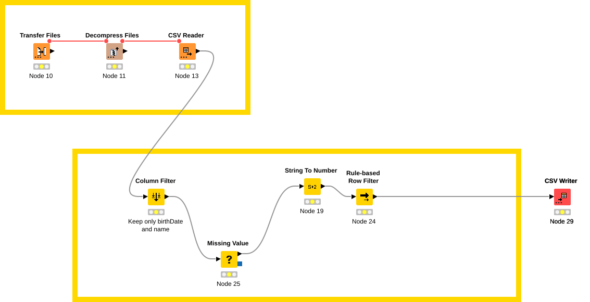

# knime_examples

A KNIME Analytics Platform workflow (`imdb_sample/`) run in batch mode, without the KNIME user
interface:



1. **Transfer Files** downloads `name.basics.tsv.gz` from the public
   [IMDb datasets](https://developer.imdb.com/non-commercial-datasets/);
2. **Decompress Files** unpacks it;
3. **CSV Reader** reads the tab-separated file;
4. **Column Filter** keeps `primaryName` and `birthYear`;
5. **Missing Value** drops the rows without a birth year;
6. **String To Number** converts `birthYear` to an integer;
7. **Rule-based Row Filter** keeps the people born after 1970;
8. **CSV Writer** writes `output.csv` in the workflow's data folder.

- **Job type:** `knime` (specialised type: available only if your installation configured the
  `knime` runtime image, KNIME Analytics Platform 5.8.4, the last series with batch execution)
- **Entry point:** the workflow archive (`archive`), a `.knwf` file or a `.zip` holding one workflow.
  The workflow was saved with KNIME 4.6 and opens in 5.8.
- **Network:** a run has no outbound access by default. The workflow downloads from
  `https://datasets.imdbws.com`, so the job lists a project data connection of type `http` for that
  host in `connections` (the run's network policy then opens it; this needs an installation whose
  network supports FQDN rules, otherwise the API answers `501 feature_disabled`). The IMDb datasets
  are for personal and non-commercial use only.
- **Output:** `output.csv` is written next to the workflow, inside the pod, and disappears with
  it; the run's log shows the outcome of each node. To keep the result, point the CSV Writer to a
  location that outlives the run (for example the project's bucket, with the KNIME Amazon S3
  connector and credentials read from `/workspace/secrets/`).
- **Memory:** the JVM heap is 70% of the instance type's memory; the uncompressed file is large, so
  choose an instance type with at least 8 GiB from `graalctl instance-types list`.

## Build

Open `imdb_sample/` in KNIME Analytics Platform to view or change it. Package it as a workflow
archive (the archive holds the `imdb_sample/` folder):

```sh
zip -r imdb_sample.knwf imdb_sample
```

## Run with graalctl

Create the data connection first (type `http`, `base_url` `https://datasets.imdbws.com`) in the
project, and note its id as `CONNECTION_ID`.

```sh
ARCHIVE_KEY=$(graalctl libraries upload imdb_sample.knwf)

sed -e "s/<IDENTITY_ID>/$IDENTITY_ID/" \
    -e "s/<LIBRARY_KEY>/$ARCHIVE_KEY/" \
    -e "s/<CONNECTION_ID>/$CONNECTION_ID/" job.json > job.local.json

JOB_ID=$(graalctl jobs create --project "$PROJECT_ID" -f job.local.json -o id)
graalctl jobs run "$JOB_ID" --follow
```

KNIME preferences (Eclipse preference keys) can be passed with `options.preferences`, a list of
`"key=value"` strings. GPUs are not available to `knime` jobs.

If the API answers `501 feature_disabled`, the `knime` type is not enabled on your installation.
The options a specialised type accepts depend on the runtime image configured there: check the
installation's API reference (`/api/v1/docs`) and adjust [`job.json`](job.json).
